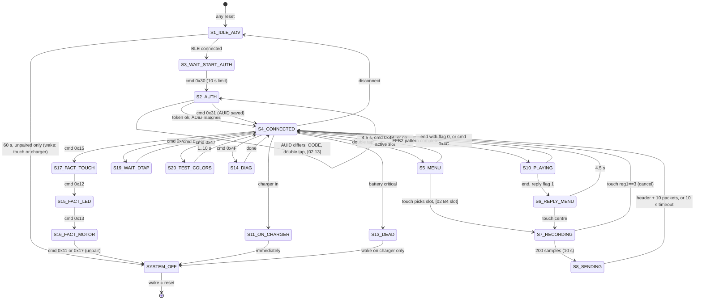

# Bond Touch More — `bond3_fsm` (0x26900–0x28900) and `nvs_storage` (0x28d84–0x29f84)

Static analysis only; nothing was modified. All jump tables were read from `reference/nrf51822_xxac.bin`. Times assume app_timer prescaler 0 (32768 ticks/s).

Three corrections to existing notes come first, because they change how the tables below read:

- **FSM event 9 is not the touch IC.** Scheduler code 6 is posted by the GPIOTE handler for P0.15 rising edge (`0x1fd78`, registered at `0x1fe18`). Touch register 1 == 3 produces touch-callback type 0 → scheduler code 5 → FSM event 6. P0.15 is most likely the accelerometer double-tap interrupt (unconfirmed). The `names.txt` comment on `0x24380` and FIRMWARE_LED_VIBE.md §12.3 row D are wrong on this.
- **Commands 0x43/0x44 are not ANCS.** They enter and leave state 19 (WAIT_DOUBLE_TAP). The ANCS flag is commands 0x53/0x57.
- **Factory commands 0x12 and 0x15 are swapped in FIRMWARE_LED_VIBE.md §12.4.** Table `0x3312c` gives 0x11→ev 0x23, 0x12→0x24, 0x13→0x25, 0x15→0x26, 0x17→0x27.

## 0. Mechanics

- **Dispatcher:** `fsm_dispatch_event(ev)` at `0x269b8` indexes table `0x333a4` with the state byte at `0x200020f6`. Each state then has its own event table; the default target `0x269ee` means "ignore".
- **Transition idiom:** `dispatch(2)` (exit) → write state → `dispatch(1)` (entry), or a direct jump into the entry body. Helper `fsm_goto(state)` is at `0x285b8`.
- **Scheduled transition:** `0x285d4` is a scheduler handler that performs a transition to state 11 or 13 only.
- **Deferred transitions:** sweep animations block in the main context with busy flag `0x20002df7` = 1 (setter `0x28674`). An event arriving meanwhile stores pending = 1 at `0x20002df8` and the target state at `0x20003017`. When the animation ends it posts event 0x1f, and the handler jumps through the entry-body table `0x33b78` (state 1) or `0x33bcc` (state 4). Only the last pending target survives.
- **Why this exists (unconfirmed):** BLE events appear to reach the FSM from the SoftDevice event interrupt, not the scheduler. A rewrite that routes everything through the scheduler does not need the mechanism.
- **Init:** `fsm_init` at `0x284d8` disables touch events 1–3 and the touch IRQ, sleeps the touch IC, powers the LEDs off, suspends the accelerometer, creates four timers, sets state 1 and dispatches event 1.

### Helpers the FSM calls

| Addr | Proposed name | Effect |
|---|---|---|
| `0x1f9bc` / `0x1f9f8` | touch_evt_disable / enable(n) | Gates touch callbacks. n=1 one finger (`0x2000254d`), 2 two fingers (`0x2000254c`), 3 register-1==3 (`0x2000254f`), 0 100 ms idle (`0x2000254e`) |
| `0x1ff7c` | touch_irq_enable(en) | GPIOTE P0.18 |
| `0x1ff60` | dtap_irq_enable(en) | GPIOTE P0.15 |
| `0x28c00` / `0x28c48` | touch_wake / touch_sleep | Reset pulse on P0.17; sleep also writes register 0xE5 = 3 |
| `0x1ff98` | charger_present | !P0.08 |
| `0x1ffac` | charge_status | P0.09 level when P0.08 is low. 0 = still charging (unconfirmed polarity meaning) |
| `0x25bc4` | notify_state(code) | FFB1 notify `[0x04, code]` |
| `0x25fa0` | ffb1_notify(buf, len) | Posts event 0x21 if the CCCD is off |
| `0x26610` | ffb2_notify(buf, len) | Posts event 0x1a if the CCCD is off |
| `0x26668` | ble_disconnect | Reason 0x13 |
| `0x265f8` / `0x2669c` | adv_start / adv_stop | |
| `0x21b00` / `0x21ad4` | display_power_on / off | P0.01 |
| `0x22364` | display_clear | |
| `0x21f68` | display_animation(n) | n = 0..11 |
| `0x226b0` | sweep, colour `0x200020b0`, speed 50 | Busy; posts event 0x1f |
| `0x226d8` | sweep, colour `0x200020ac`, speed 100 | Busy; posts event 0x1f |
| `0x22700` | slot-colour sweep(slot) | Busy; posts event 0x1f |
| `0x22b30` / `0x22b4c` / `0x22b68` | display scheduler events 0 / 6 / 7 | Animations 5 / 6 / 7 |
| `0x242d0` / `0x24340` | accel_suspend / accel_resume | Bit-banged bus on P0.10/11/14 (unconfirmed part) |
| `0x22be0` / `0x22ccc` / `0x237f4` | motors start / stop / silence | |
| `0x23224` | motor power pins off | |
| `0x23850` | double buzz | |
| `0x1fa74` | battery timer (120 s) on/off | |
| `0x1faac` | 1 s statistics timer on/off | |
| `0x248c4` | allow low-battery animation flag | `0x200020d5` |
| `0x268e8` | tx-in-progress flag | `0x20002df0` |
| `0x28d74` | wdt_feed | Reload 3000 ms (`0x33c8c`) |
| `0x26900` | `sd_power_system_off` | SVC 0x3C |

## 1. Events

| Ev | Meaning | Posted by |
|---|---|---|
| 1 / 2 | ENTRY / EXIT | FSM itself |
| 3 | TIMER | T_A or T_B expiry → scheduler code 10 → `0x24470` |
| 4 | TOUCH_1: one finger, raw Y at `0x200024eb` | Touch IRQ P0.18 → `0x28970` → callback `0x1f784` type 2 → scheduler 3 |
| 5 | TOUCH_2: two fingers, raw Y at `0x200024e9` / `0x200024ea` | Callback type 1 → scheduler 4 |
| 6 | TOUCH_GESTURE3: touch register 1 == 3 | Callback type 0 → scheduler 5 |
| 7 | TOUCH_IDLE: no report for 100 ms | Timer `0x20003048` → `0x286e8` → callback type 3 → scheduler 2 |
| 9 | DOUBLE_TAP | P0.15 rising → `0x1fd78` → scheduler 6 → `0x243c2` |
| 0x0a | CHARGER_IN | P0.08 falling → `0x1fdb0` → scheduler 8 (also pulses P0.19 low) |
| 0x0b | CHARGER_OUT | P0.08 rising → scheduler 9 |
| 0x0c | BLE connected | GAP event 0x10 (`0x262da`) |
| 0x0d | BLE disconnected | GAP event 0x11 (`0x261be`) |
| 0x0f | Advertising idle/timeout | `0x25468` |
| 0x10 | Start authentication | FFB1 `[1, 0x30]` |
| 0x11 | Token OK | FFB1 `[3]` + "12345678" (`0x2647a`) |
| 0x12 / 0x13 | AUID equals / differs from stored | FFB1 `[7, u32]` (`0x263e0`) |
| 0x14 | Paired acknowledgement | FFB1 `[1, 0x31]` |
| 0x15 | Touch pattern fully received | FFB2 → `ffb2_on_write` → display scheduler event 5 (`0x21eb8`) |
| 0x16 | BLE TX complete, only while tx flag is set | BLE event 1 (`0x262a2`) |
| 0x17 | FFB1 prefix 0x0A written | `0x26386`; no state handles it |
| 0x18 / 0x19 | Commands 0x43 / 0x44 | app_cmd |
| 0x1a | FFB2 notify refused (CCCD off) | `0x26652` |
| 0x1b | Test colours | Command 0x47 → display scheduler event 4 (`0x21ea4`) |
| 0x1c | Battery critical | Scheduler 7 (120 s measurement) with battery state 3 (`0x243da`) |
| 0x1d | Stop playback | Command 0x4C |
| 0x1e | LED colour command; also self-posted when the menu is empty | Command 0x4B; `0x28162` |
| 0x1f | Sweep animation finished | `0x226ce`, `0x226f6`, `0x22730`, `0x228ba`, `0x22a60` |
| 0x20 | Diagnostics dump | Command 0x4F |
| 0x21 | FFB1 notify refused (CCCD off) | `0x25c2e`, `0x26002` |
| 0x23–0x27 | Factory commands 0x11, 0x12, 0x13, 0x15, 0x17 | app_cmd |

Events 8, 0x0e and 0x22 are never posted.

## 1a. State table

| # | Proposed name | State code sent | Event table | Entry |
|---|---|---|---|---|
| 0 | RESTART_DELAY | – | inline `0x26a9e` | `0x26c96` |
| 1 | IDLE_ADVERTISING ("START") | 0x01 | `0x33728` | `0x26ab2` |
| 2 | AUTH (sub-state at `0x20002e80`) | 0x82 / 0x83 / 0x84 / 0x8a | `0x336b4` | `0x27e86` |
| 3 | WAITING_START_AUTH | 0x8f | `0x33848` | `0x2778e` |
| 4 | CONNECTED | 0x85 | `0x339d4` | `0x2739e` |
| 5 | MENU | 0x88 | `0x33578` | `0x27ec2` |
| 6 | REPLY_MENU | 0x89 | `0x33a70` | `0x27538` |
| 7 | MSG_RECORDING | 0x86 | `0x335f4` | `0x2773e` |
| 8 | MSG_SENDING | – | `0x333f8` | `0x270da` |
| 9 | unused | | | |
| 10 | MSG_PLAYING | 0x87 | `0x3395c` | `0x275bc` |
| 11 | ON_CHARGER | 0x8b charging / 0x8c full | inline `0x26ad4` | `0x26c38` |
| 12 | CHARGED | 0x8c | inline `0x269d2` | `0x26cae` |
| 13 | BATTERY_DEAD_OFF | – | inline `0x26b9e` | `0x26ba4` |
| 14 | DIAG_DUMP | – | `0x3362c` | `0x27b66` |
| 15 | FACTORY_LED | – | `0x338bc` | `0x27dbc` |
| 16 | FACTORY_MOTOR | – | `0x337a8` | `0x27cda` |
| 17 | FACTORY_TOUCH | – | `0x33464` | `0x27f52` |
| 18 | unused | | | |
| 19 | WAIT_DOUBLE_TAP | 0x8d | `0x33504` | `0x27e9c` |
| 20 | TEST_COLORS | 0x8e | `0x33ae4` | `0x276c8` |

## 1b. Per-state transitions

"→ N*" means: go now if not busy, otherwise store N as pending.

**State 0 – RESTART_DELAY**

| Ev | Handler | Action | Next |
|---|---|---|---|
| 1 | `0x26c96` | Start T_B, 100 ms | |
| 3 | `0x26aa8` | | 1 |

**State 1 – IDLE_ADVERTISING**

| Ev | Handler | Action | Next |
|---|---|---|---|
| 1 | `0x26ab2` | LEDs on, accelerometer suspend, touch IRQ on, touch wake, enable one-finger events, sweep (colour 70 50 40) | |
| 2 | `0x277a6` | Double-tap IRQ off | |
| 0x1f | `0x278f2` | LEDs off. If pending: execute it. Otherwise (`0x2819e`): notify 0x01, double-tap IRQ on, then the charger check and advertising below | 11 / 12 / stay |
| 3 | `0x277b0` | Advertising stop, LEDs off, accelerometer suspend, motors off, GPIO parked, wake on P0.18 low or P0.08 low, system off | off |
| 4, 9 | `0x26fe4` | Disable one-finger events, animation 6, start T_C 2 s | |
| 0x0a | `0x27924` | Stop T_B | 11* |
| 0x0c | `0x278ce` | Stop T_B | 3* |
| 0x0d | `0x278a8` | Stop T_B | 0* |
| 0x0f | `0x2784a` | Restart advertising | |
| 0x1c | `0x2782a` | Stop T_B | 13* |

Detail of the not-pending branch at `0x2819e`:
- If the charger is present: go to state 11 when `charge_status` is 0, otherwise state 12.
- Otherwise start advertising. Start T_B at 60 s only if the bracelet is not paired (`0x29194` returns 0). A paired bracelet advertises indefinitely.

Detail of the system-off at `0x277b0`: every pin is disconnected except 8, 17, 18 (and pin 1 unless the board is Rev 1). `PIN_CNF[18]` and `PIN_CNF[8]` are set to 0x0003000C (sense low, pull-up).

**State 2 – AUTH** (sub-state: 1 token, 2 AUID, 3 OOBE, 4 waiting for app acknowledgement)

| Ev | Handler | Action | Next |
|---|---|---|---|
| 1 | `0x27e86` → `0x2744a` | Notify 0x82, sub = 1, T_B 60 s | |
| 2 | `0x272da` | sub = 0, double-tap IRQ off, low-battery animation allowed, LEDs off | |
| 3 | `0x272c6` | Notify `[02 14]`, disconnect | (1 on disconnect) |
| 0x11 | `0x27226` | If sub 1: notify 0x83, sub = 2, T_B 60 s | |
| 0x12 | `0x2720a` | If sub 2: stop T_B | 4 |
| 0x13 | `0x27318` | If sub 2: notify 0x84, all LEDs colour 70 50 40, accelerometer resume, double-tap IRQ on, sub = 3, T_B 60 s | |
| 9 | `0x2728c` | If sub 3: notify 0x8a, sub = 4, notify `[02 13]`, T_B 60 s | |
| 0x14 | `0x272f4` | If sub 4: stop T_B, clear LEDs, schedule AUID save (`0x25f8c` → `0x29098`) | 4 |
| 0x0a | `0x27272` | Stop T_B | 11 |
| 0x0d | `0x27254` | Stop T_B, accelerometer suspend | 1 |
| 0x1c | `0x27370` | Stop T_B | 13 |

**State 3 – WAITING_START_AUTH**

| Ev | Handler | Action | Next |
|---|---|---|---|
| 1 | `0x2778e` | Notify 0x8f, T_B 10 s | |
| 3 | `0x2746a` | Disconnect | |
| 0x10 | `0x27432` | Stop T_B | 2 |
| 0x0a | `0x26c1e` | Stop T_B | 11 |
| 0x0d | `0x27466` | Stop T_B | 1 |
| 0x1c | `0x271f8` | Stop T_B | 13 |

**State 4 – CONNECTED**

| Ev | Handler | Action | Next |
|---|---|---|---|
| 1 | `0x2739e` | LEDs on, accelerometer resume, sweep | |
| 2 | `0x277a6` | Double-tap IRQ off | |
| 0x1f | `0x27bbc` | LEDs off, double-tap IRQ on. If pending: execute. Otherwise (`0x282c4`) notify 0x85; if the charger is present go to 11 or 12 | |
| 9 | `0x27c0c` | | 5* |
| 0x15 | `0x27c5c` | | 10* |
| 0x18 | `0x27c42` | | 19* |
| 0x1b | `0x27c76` | | 20* |
| 0x20 | `0x27b4c` | | 14 |
| 0x26 | `0x27b14` | | 17* |
| 0x0a | `0x27c26` | | 11* |
| 0x0d | `0x27bf2` | | 1* |
| 0x1c | `0x27b30` | | 13* |

Bar touches are not handled in state 4; the touch IC is asleep there. The bar becomes live only after a double tap.

**State 5 – MENU**

| Ev | Handler | Action | Next |
|---|---|---|---|
| 1 | `0x27ec2` | mask = `settings_active_slot_mask()`, stored at `0x20002df6`. If 0: 500 ms wait, post event 0x1e. Otherwise notify 0x88, LEDs on, `display_partner_menu(mask)`, 450 ms blocking wait, T_B 4.5 s, touch IRQ on, touch wake, enable one-finger events | |
| 2 | `0x271ae` | If flag `0x200020f7` is set: stop T_B, clear, disable one-finger events, LEDs off. Always: allow low-battery animation | |
| 3, 0x1e | `0x26f78` | Touch IRQ off, touch sleep | 4* |
| 4 | `0x271c4` | Pick slot (below), store at `0x20003016`, notify `[02 B4 slot]` (`0x27e34`) | 7 |
| 0x0a | `0x27164` | Touch off | 11* |
| 0x0d | `0x27108` | Touch off | 1* |
| 0x1c | `0x27188` | Touch off | 13* |

Slot selection uses v = 240 − rawY and p = v / 26 (9 becomes 8), via table `0x33b58` indexed by mask:

| Mask | Result |
|---|---|
| 1, 2, 4 | That slot |
| 3 | v ≤ 129 → slot 1, else slot 2 |
| 5 | v ≤ 129 → slot 1, else slot 3 |
| 6 | v ≤ 129 → slot 2, else slot 3 |
| 7 | slot = p / 3 + 1 (LED thirds) |
| 0 | slot 0 |

**State 6 – REPLY_MENU**

| Ev | Handler | Action | Next |
|---|---|---|---|
| 1 | `0x27538` | Notify 0x89, LEDs on, animation 7, 450 ms wait, T_B 4.5 s, touch on, enable one-finger events | |
| 2 | `0x27674` | Stop T_B, stop animation, disable one-finger events, LEDs off | |
| 3 | `0x2738a` | Touch off | 4 |
| 4 | `0x27658` | If position == 4 (centre): reply slot = received slot (`0x20003015` → `0x20003016`). Any other position: re-enable and ignore | 7 |
| 0x0a | `0x27718` | Touch off | 11 |
| 0x0d | `0x275f8` | Touch off | 1 |
| 0x1c | `0x27694` | Touch off | 13 |

**State 7 – MSG_RECORDING**

| Ev | Handler | Action | Next |
|---|---|---|---|
| 1 | `0x2773e` | Notify 0x86, LEDs on, battery and statistics timers off, slot-colour sweep if mask > 1, enable events 1/2/3, motors start, colour mode 3, T_A 50 ms repeating | |
| 2 | `0x26f52` | Disable event 3, motors stop, timers back on, touch IRQ off, touch sleep, LEDs off | |
| 4 | `0x26eca` | Disable events 1/2 and the IRQ; `buf[count++] = 0xF0 | p`; light LED p; pan motor to p | |
| 5 | `0x26e56` | `buf[count++] = (p2 << 4) | p1`; LEDs p1..p2; motor at (p1 + p2) / 2 | |
| 3 | `0x26f1e` | If count > 199: finish (`0x2830c`: stop T_A, slot sweep) → state 8. Otherwise, if nothing was stored this window, append 0xFF and turn LED and motor off; then last = 0xFF, re-enable events 1/2 and the IRQ | 8 at 200 |
| 6 | `0x26e0e` | Cancel: stop, count = 0, sweep in colour 90 00 00 | 4 |
| 0x0a | `0x26dca` | Abort | 11 |
| 0x0d | `0x26d82` | Abort, animation 5 | 1 |

**State 8 – MSG_SENDING**

| Ev | Handler | Action | Next |
|---|---|---|---|
| 1 | `0x270da` | T_B 10 s, tx flag = 1, FFB2 notify header `[slot, 0xC8, 0x0A, 0…]` (20 bytes), total = 10 | |
| 0x16 | `0x2704a` | If index < 10: notify `buf[index * 20 ..]` (20 bytes), index++. Otherwise (`0x28086`) schedule "sent counter + save statistics" | 4 when done |
| 3, 0x1a | `0x26d6c` | Animation 5 | 4 |
| 0x0d | `0x27020` | Animation 5 | 1 |
| 2 | `0x27036` | index = 0, stop T_B, tx flag = 0 | |

State 8 has no charger or battery-critical handler.

**State 10 – MSG_PLAYING**

| Ev | Handler | Action | Next |
|---|---|---|---|
| 1 | `0x275bc` | Timers off, notify 0x87, motors start, count = header byte 1, LEDs on. If the reply flag `0x20002e7c` is set: double buzz and received-slot sweep. T_A 50 ms | |
| 3 | `0x274b0` | Play one sample (below). After the last one: stop, schedule "received counter + save statistics" | 6 if reply flag, else 4 |
| 0x1d | `0x27404` | Stop | 4 |
| 0x0a | `0x27472` | Stop T_A | 11 |
| 0x0d | `0x27428` | Stop T_A | 1 |
| 2 | `0x27596` | Timers on, motors stop, clear, LEDs off | |

Sample decoding: `b = playbuf[index]`. 0xFF means LEDs and motor off. A high nibble of 0xF means one finger at `b & 15`. Otherwise two fingers. The third argument of `display_show` is the sample index (for the time gradient).

**States 11 / 12 – ON_CHARGER / CHARGED**

| State | Ev | Handler | Action |
|---|---|---|---|
| 11 | 1 | `0x26c38` | Charge counter++. Then one of the two branches below |
| 12 | 1 | `0x26cae` | Notify 0x8c, LEDs 3–5 white, wake on P0.08 high, system off |
| 12 | 2 | `0x26c18` | LEDs off |
| 11 / 12 | 0x0b | `0x26aea` / `0x26c00` | Battery ≥ 80 % → animation 10; ≤ critical → animation 9; ≤ low → animation 8; then state 1 |

State 11 entry branches:
- Still charging (`0x28008`): notify 0x8b, disconnect, animation 0, sleep peripherals, `PIN_CNF[8]` and `PIN_CNF[9]` = 0x0002000C (wake on high), system off.
- Full: notify 0x8c, disconnect, LEDs 3–5 white (`display_mask_color(0x38, 0xFFFFFF)`), wake on P0.08 high only, system off.

The MCU is in system-off for the whole time on the charger and reboots on unplug, so the event 0x0b handlers are normally unreachable. The white "charged" LEDs stay lit because the LED driver keeps its state (unconfirmed).

**State 13 – BATTERY_DEAD_OFF** (event 1 only, `0x26ba4`): disconnect, animation 2, 100 ms, sleep peripherals, `PIN_CNF[8]` = 0x0003000C, system off. Only plugging the charger wakes it.

**State 14 – DIAG_DUMP**

| Ev | Handler | Action | Next |
|---|---|---|---|
| 1 | `0x27b66` | FFB1 notify `[0A 4F, u16 app-error count, u32 error id, u32 error info]`, T_B 3 s, tx flag = 1 | |
| 0x16 | `0x273b2` | Two more 20-byte packets (`0x280aa`, `0x28420`), then clear the diagnostics block (`0x29ea4`) and bump its dump counter (`0x29f30`) | 4 |
| 3, 0x21 | `0x26fd2` | | 4 |
| 0x0d | `0x273f0` | | 1 |
| 2 | `0x273da` | index = 0, stop T_B, tx flag = 0 | |

**States 15 / 16 / 17 – factory**

| State | Ev | Handler | Action | Next |
|---|---|---|---|---|
| 17 | 1 | `0x27f52` | LEDs on, touch on, enable events 0–3 | |
| 17 | 4 / 5 / 6 / 7 | `0x27ace` / `0x27a38` / `0x27a20` / `0x27a06` | Notify `[A1 15 01 p]`, `[A1 15 02 p1 p2]`, `[A1 15 03]`, `[A1 15 04]`; only every second report is notified (counter `0x20003014`) | |
| 17 | 0x24 | `0x27946` | | 15 |
| 17 | 0x27 | `0x2797e` | Notify `[A1 15 05]`, clear AUID, system off | off |
| 15 | 1 / 3 | `0x27dbc` / `0x27d90` | All LEDs cycle 90 00 00 → 00 C0 00 → 00 00 FF, T_B 0.5 s | |
| 15 | 0x25 | `0x27cd0` | | 16 |
| 15 | 0x0d, 0x27 | `0x26ffc` | Clear AUID, system off | off |
| 16 | 1 / 3 | `0x27cda` / `0x27cbc` | Alternate LED 8 + motor position 0 and LED 0 + motor position 8, T_B 0.5 s | |
| 16 | 0x0d, 0x23, 0x27 | `0x26f9c` | Stop, clear AUID, system off | off |
| 15–17 | 0x0a | `0x27d74`, `0x27d0a`, `0x279e2` | Clear AUID | 11 |
| 15–17 | 0x1c | `0x27e0e`, `0x27d52`, `0x2795a` | Clear AUID | 13 |

Leaving factory mode always schedules `0x26940` (write AUID 0, i.e. unpair) and `0x26954` (system off, wake on touch or charger). Factory mode is entered from state 4 by command 0x15.

**State 19 – WAIT_DOUBLE_TAP**

| Ev | Handler | Action | Next |
|---|---|---|---|
| 1 | `0x27e9c` | Notify 0x8d, double-tap IRQ on | |
| 9 | `0x270a8` | Notify `[02 B2]` | |
| 0x19 | `0x27072` | | 4 |
| 0x0a / 0x0d / 0x1c | `0x27096` / `0x27084` / `0x270ba` | | 11 / 1 / 13 |
| 2 | `0x270b2` | Double-tap IRQ off | |

**State 20 – TEST_COLORS**

| Ev | Handler | Action | Next |
|---|---|---|---|
| 1 | `0x276c8` | Notify 0x8e, `display_test_colors_split`, T_B = seconds (1..10) | |
| 0x1b | `0x27610` | Repaint and restart T_B | |
| 3 | `0x27394` | | 4 |
| 0x0a / 0x0d / 0x1c | `0x26c24` / `0x26aa8` / `0x271fe` | | 11 / 1 / 13 |
| 2 | `0x276a0` | Clear, LEDs off, stop T_B, double-tap IRQ off | |

## 1c. Main paths

### Topic answers

- **Power on.** There is no user on/off control. Every wake is a reset into state 1 (sweep, notify 0x01, charger check, advertise).
  - Unpaired: system-off after 60 s; touching the bar or plugging the charger wakes it.
  - Paired: never sleeps; it advertises until the battery is critical.
  - Battery critical: state 13, charger-only wake.
- **Recording.**
  - Sampling: the touch IRQ on P0.18 triggers a read and re-arms a 30 ms re-poll timer (`0x20002558`, 0x3D7 ticks). The first report in each 50 ms window wins; an empty window stores 0xFF.
  - Position: (240 − Y) / 26, clamped to 8.
  - Length: fixed at 200 samples = 10 s. I found no end-of-touch timeout: event 7 is not enabled in state 7.
  - Transport: FFB2 notifications, one header plus 10 × 20 bytes, each sent on TX complete, with a 10 s watchdog timer.
- **Receiving and playing.**
  - `ffb2_on_write` copies packets straight into the play buffer in any state. Timer T_D resets the packet counter 10 s after the header.
  - Event 0x15 is honoured only in state 4. There is no queue, no on-device replay and no missed-touch indicator; a pattern arriving in any other state is dropped, and may corrupt a playback in progress.
  - Header byte 9 = 1 adds the intro buzz and sweep, and the REPLY_MENU afterwards.
- **Do-not-disturb.** No such mode exists. State 19 is the closest: it ignores incoming patterns and reports double taps to the app instead of opening the menu (purpose unconfirmed).
- **DFU.** Not an FSM state. Command 0x2A (`0x24dfe`): animation 11 on Rev 2, `sd_power_gpregret_set(0xB1)`, 1.5 s wait, system reset. The app error/fault handler takes the same route (`0x1fbec`), so any assert reboots into the bootloader's DFU mode.

## 2. Timers

Timer id table at `0x33c20`; all created in `0x284d8`.

| Id (RAM) | Mode | Handler | Periods used | Purpose |
|---|---|---|---|---|
| T_A `0x20002dfc` | Repeated | `0x26990` → scheduler 10 → event 3 | 50 ms (0x666) | Sample tick in states 7 and 10 |
| T_B `0x20002e3c` | Single | `0x26918` → scheduler 10 → event 3 | See list below | State timeout |
| T_C `0x20002e1c` | Single | `0x2690c` → `touch_evt_enable(1)` | 2 s | Rate-limits the "touched while idle" animation in state 1 |
| T_D `0x20002e5c` | Single | `0x26904` → `0x268b0` (packet counter = 0) | 10 000 ms (`0x28680`, started at `0x254da`) | FFB2 reassembly timeout |

T_B periods by state:
- State 0: 100 ms (0xCCD)
- State 1 (unpaired only), state 2: 60 s (0x1E0000)
- State 3, state 8: 10 s (0x50000)
- States 5, 6: 4.5 s (0x24000)
- State 14: 3 s (0x18000)
- States 15, 16: 0.5 s (0x4000)
- State 20: 1..10 s

Timers the FSM gates but does not own:

| Id | Mode / period | Handler | Purpose |
|---|---|---|---|
| `0x200024ec` | Repeated, 120 s | `0x1f824` → scheduler 7 | Battery measurement |
| `0x2000252c` | Repeated, 1 s | `0x1f75c` → scheduler 11 | Uptime counters |
| `0x20002558` | Single, 30 ms | `0x1fd70` | Touch re-poll |
| `0x20003048` | Single, 100 ms | `0x286e8` | Touch idle |

## 3. RAM

| Addr | Size | Meaning |
|---|---|---|
| `0x200020f6` | 1 | Current state (initial 1) |
| `0x20002df7` | 1 | Busy (sweep animation running) |
| `0x20002df8` | 1 | Pending-transition flag |
| `0x20003017` | 1 | Pending target state |
| `0x20002e80` | 1 | Auth sub-state (1..4) |
| `0x20002df6` | 1 | Menu active-slot mask |
| `0x200020f7` | 1 | "Menu was drawn" flag, initial 1; cleared at `0x28140`, never set again (see open questions) |
| `0x20003016` | 1 | Slot being recorded / sent (1..3) |
| `0x20003015` | 1 | Slot of the received pattern (setter `0x285f8`, getter `0x28604`) |
| `0x20002f4c` | 200 | Record buffer |
| `0x20002e7f` | 1 | Record count |
| `0x200020f8`, `0x200020f9` | 1 + 1 | Position(s) recorded in this window; 0xFF = none |
| `0x20002e84` | 200 | Play buffer (`0x28610` copies packet n to (n − 1) × 20) |
| `0x20002e7e` | 1 | Play sample count |
| `0x20002dfa` | 1 | Play index |
| `0x20002e7c` | 1 | Reply flag (header byte 9; setter `0x28668`) |
| `0x20002e7d`, `0x20002e82` | 1 + 1 | Send: total packets (10), next index |
| `0x20002e81` | 1 | Diagnostics dump packet index |
| `0x20002df9`, `0x200020fa` | 1 + 1 | Factory LED step, factory motor step |
| `0x20003014` | 1 | Factory touch report counter |
| `0x20003018`, `0x2000301c`, `0x2000301f` | 3 + 3 + 1 | Test colour 1, colour 2, seconds |
| `0x20003020` | ≥ 8 | Written by command 0x36 (`0x286c4`, `0x286d8`); never read |
| `0x200020a4`, `…a8`, `…ac`, `…b0` | 3 each | Fixed colours: 00 00 FF, 00 C0 00, 90 00 00, 70 50 40 |

BLE-side variables the FSM depends on:

| Addr | Meaning |
|---|---|
| `0x20002858` | FFB2 packet (20 bytes) |
| `0x20002df2` | Receive packet counter |
| `0x20002df3` / `0x20002df4` | Header sample count / packet count |
| `0x20002634` / `0x20002630` | Pattern colour 1 / colour 2 |
| `0x20002603` | Colour mode |
| `0x20002df0` | tx-in-progress |
| `0x20002df1` / `0x20002df5` | FFB1 / FFB2 CCCD enabled |
| `0x20002841` | Connected |
| `0x20002838` | Advertising |
| `0x200020e0` | Last state code sent |
| `0x2000283c` | AUID written by the app |
| `0x200027e8` | Battery state (1 ok, 2 low, 3 critical) |
| `0x200027ec` | Battery percent (u8) and mV (u16 at +2) |

## 4. nvs_storage

### Records

Table at `0x33cd8`. Each record is one chunk, stored twice.

| Record | Primary file / key | Copy file / key | RAM primary / copy | Size | Save function |
|---|---|---|---|---|---|
| A – device | 0x0050 / 0x0040 | 0x0060 / 0x0040 | `0x20003078` / `0x20003088` | 16 B (4 words) | `0x28ec0` |
| B – settings | 0x0080 / 0x0070 | 0x0090 / 0x0070 | `0x20003098` / `0x200030bc` | 36 B (9 words) | `0x28fa4` |
| C – statistics | 0x00B0 / 0x00A0 | 0x00C0 / 0x00A0 | `0x200030e0` / `0x200030f4` | 20 B (5 words) | `0x28ddc` |

**Record A**

| Off | Size | Field | Default |
|---|---|---|---|
| 0 | u16 | Schema version | 2 |
| 2 | u16 | Unused | |
| 4 | u16 | Write counter | 0 |
| 8 | u32 | Lot number (command 0x18 sets, 0x19 reads → 0xAA) | 0 |
| 12 | u32 | Device id (command 0x1A sets, 0x1B reads → 0xAB) | FICR DEVICEADDR[0] (`0x100000A4`) |

**Record B**

| Off | Size | Field | Default | Range |
|---|---|---|---|---|
| 0 | u16 | Write counter | 0 | |
| 2 | u16 | Firmware version, packed gen << 12 \| a << 6 \| b = 0x3041 (3.1.1) | Synced at boot by `0x292bc` | |
| 4 | u32 | Owner AUID; 0 = unpaired | 0 | |
| 8 | u8 | Vibration level | 50 | ≤ 100 |
| 9 | u8 | Vibration balance | 2 | 0..4 |
| 10 | u8 | ANCS flag (commands 0x53 / 0x57) | 0 | |
| 12 | u32 | Slot 1: R, G, B in bytes 0–2; active = bit 0 of byte 3 | BF EB 23, inactive | Active byte must be 0 or 1 |
| 16 | u32 | Slot 2 | 23 91 EB, inactive | |
| 20 | u32 | Slot 3 | BF 26 BF, inactive | |
| 24 | u8 + 3 | Low-battery percent, then its R G B | 15, F8 92 00 | |
| 28 | u8 + 3 | Critical percent, then its R G B | 5, FF 00 00 | |
| 32 | u8 | Accelerometer sensitivity | 10 | ≤ 31 |
| 33 | u8 | Brightness | 200 | No check in setter |
| 34 | u8 | LED current, low nibble | Not set by defaults (0 on a virgin unit); 1 after v1 → v2 migration | 0–3 and 8–14 accepted (`0x29dbc`) |

There are exactly three partner slots: colour plus an active bit, with no name or id. The only owner data kept outside the Peer Manager is the AUID at B+4. Colour mode, test colours and pattern colours are RAM-only.

**Record C**

| Off | Size | Field |
|---|---|---|
| 0 | u16 | Write counter |
| 4 | u32 | Boot count (incremented in init) |
| 8 | u32 | Last RESETREAS |
| 12 | u32 | Touches sent |
| 16 | u32 | Touches played |

### Defaults, load and versioning

- **Defaults** are code, not a flash image: `nvs_load_defaults` at `0x291b0`, constants at `0x29290`–`0x292a8`.
- **Load** (`nvs_init`, `0x2953c`): `fds_register(0x28d88)`, `fds_init`, wait for the init event, GC if dirty records > 3, then find and open all six records.
  - If any one is missing: load defaults and `fds_record_write` all six.
  - `FDS_ERR_NO_PAGES` (0xB) from `fds_init`: system reset.
  - The copies are never used for recovery. The copy path is unreachable because the "primary found" flag is always 1 when it is tested (`0x297ba`).
- **Versioning** (`0x29672`, field A+0):
  - 0: assert.
  - 1: migrate — LED current = 1, brightness = 200, version = 2.
  - 2: current.
  - Above 2: `0x29394` deletes all six files (with GC) and loads defaults.

### When records are written

There is no debounce and no write on power-off. Every save updates primary and copy with `fds_record_update`, busy-waits on the FDS event flags (`0x2000315a`, `…5b`, `…5c`) while feeding the watchdog, and runs `fds_gc` whenever `fds_stat` reports more than 3 dirty records — roughly every second save.

| Trigger | Records |
|---|---|
| Every boot (`0x29696`) | A, B and C |
| Firmware version change (`0x292bc`) | B |
| Setting commands 0x45, 0x48 (save form), 0x49, 0x4A, 0x4D, 0x4E, 0x53 → scheduler event 5 → `0x29384` | B |
| AUID set or cleared (`0x29098`) | B, twice |
| Touch sent / touch played (scheduler events 3 / 4 → `0x2938c`) | C |
| Commands 0x18 / 0x1A | A |

### Function list

| Addr | Function |
|---|---|
| `0x28d88` | FDS event handler (clears busy flags; sets init-done `0x20003158`) |
| `0x28ddc` / `0x28ec0` / `0x28fa4` | Save C / A / B |
| `0x29088` / `0x29098` | Get / set AUID |
| `0x29194` | Is paired (settings loaded and AUID ≠ 0) |
| `0x291b0` | Load defaults |
| `0x292b0` / `0x292bc` | Get packed firmware version / sync it |
| `0x2932c` / `0x29338` | Get / set device id |
| `0x29358` / `0x29364` | Get / set lot number |
| `0x29384` / `0x2938c` | Save settings / save statistics |
| `0x29394` | Erase all six files |
| `0x2953c` | Init |
| `0x29b9c` / `0x29ba8` | Get sent / played counts |
| `0x29bb4` / `0x29bc4` | Increment sent / played |
| `0x29bd4` / `0x29be0` | Get boot count / reset reason |
| `0x29bec` | Get the three write counters (6 bytes; command 0x42) |
| `0x29c1c` / `0x29c28` | Set / get ANCS flag |
| `0x29c34` | `settings_active_slot_mask` |
| `0x29c54` / `0x29c98` / `0x29cc0` | Set slot colour / get slot word / set slot active |
| `0x29d00` | Reset battery thresholds to default |
| `0x29d18` | Get (low, critical) percent |
| `0x29d28` | Get battery colour (0 = low, 1 = critical) |
| `0x29d50` / `0x29d64` | Set / get the 8-byte battery config |
| `0x29d7c` / `0x29d98` | Set / get accelerometer sensitivity |
| `0x29da4` / `0x29db0` | Set / get brightness |
| `0x29dbc` / `0x29ddc` | Set / get LED current |
| `0x29de8` / `0x29df4` / `0x29e00` | Get vibration level / balance; set (level, balance, save) |

### Retained diagnostics block (same source file, not FDS)

`0x20007F80`, 0x26 bytes, magic 0xCAFE at +0x16; survives reset. Initialised by `0x29e78`, cleared by `0x29ea4`.

| Off | Field | Accessors |
|---|---|---|
| +0 | Disconnect count | `0x29ef8`, `0x29f08` |
| +4 | Uptime seconds | `0x29ec0`, `0x29ed0` |
| +8 | Seconds not connected | `0x29edc`, `0x29eec` |
| +0xC / +0x10 | Hard-fault count / PC | `0x29e34`, `0x29e60`, `0x29e6c` |
| +0xE | Watchdog reset count | `0x29e44`, `0x29e54` |
| +0x14 | Charge count | `0x29f14`, `0x29f24` |
| +0x18 / +0x1C / +0x20 | App error id / info / count | `0x29f4c`, `0x29f60`–`0x29f78` |
| +0x24 | Dump count | `0x29f30`, `0x29f40` |

## 5. Flash budget

- One `fs_config` only, in `.data` at `0x20002124` (image offset `0x3419c`): callback `0x1c6e5`, `num_pages` = 3, priority 0xFF. This matches `FDS_VIRTUAL_PAGES` 3 and `FDS_VIRTUAL_PAGE_SIZE` 256 words.
- Placement (`fs_init`, `0x1d35c`): end = UICR `0x10001014` (bootloader start), or CODESIZE × 1024 if unset; start = end − 0xC00. So FDS occupies the three 1 KB pages directly below the bootloader.
- One page is swap, leaving 2 × 254 = 508 data words, shared with Peer Manager bonds. The app's six live records take 54 words.
- The app image is `0x1B000`–`0x341AC` (102 828 bytes).
- The bootloader address is not in this image, so the absolute FDS addresses are unconfirmed.

## 6. What a rewrite must reproduce, and what it can drop

**Keep (phone apps or the user depend on it):**
- State notifications `[04, code]` with codes 0x01, 0x82, 0x83, 0x84, 0x85, 0x86, 0x87, 0x88, 0x89, 0x8a, 0x8b, 0x8c, 0x8d, 0x8e, 0x8f.
- Bond events `[02 13]`, `[02 14]`, `[02 B2]`, `[02 B4 slot]`.
- The handshake: connect → 0x8f → command 0x30 (10 s) → 0x82 → token → 0x83 → AUID → 0x85, or 0x84 → double tap → 0x8a + `[02 13]` → command 0x31 → store AUID → 0x85. 60 s timeouts, each ending in a disconnect.
- Touch transmit format: header `[slot, 200, 10]` plus 10 × 20 bytes at 50 ms per sample, paced by TX complete.
- Touch receive: header `[slot, n, packets, c1, c2, replyFlag]`, 50 ms playback, reply menu when the flag is set, command 0x4C to stop.
- Menu behaviour: double tap opens it, zones follow the active mask, 4.5 s timeout, and it does not open with no active slot.
- Settings layout and defaults of record B. If existing data must survive the swap, also keep the file ids and keys.
- AUID semantics (0 = unpaired) and the unpaired 60 s sleep with touch/charger wake.
- Charger behaviour: system-off on the charger, wake pins, 0x8b / 0x8c codes; battery critical → off with charger-only wake.
- DFU entry via GPREGRET 0xB1 (command 0x2A).
- Acknowledgements `[0A, cmd, …]` and the 0xAA–0xB1 replies.

**Droppable:**
- The busy/pending mechanism, if all events go through the scheduler.
- State 0's 100 ms hop.
- The duplicate record copies (never read back).
- Saving A, B and C on every boot, and the GC-every-second-save policy.
- State 14 and the retained diagnostics block; the lot number and device-id writers; the command 0x36 store.
- Factory states 15–17, if factory tooling is not needed.
- State 19, unless the app's double-tap feature is wanted.
- The fixed 10 s recording could end early on idle, since the app strips leading and trailing 0xFF. The 200-sample header, or at least a consistent count, must stay.

## Open questions

1. What is on P0.15, and which accelerometer part is on the bit-banged bus? The "double tap" label rests on the app's naming plus the accelerometer-sensitivity command 0x4A.
2. Which physical gesture makes the touch IC report register 1 == 3 (cancel)? CST816 "slide left" would fit, but the part is unconfirmed.
3. P0.09 polarity (charging vs full), and whether the LEDs really stay lit during system-off.
4. `0x200020f7` is cleared the first time the menu opens with no active slot and never set again. After that, the menu exit skips stopping T_B and clearing the display until the next reset. Is this a vendor bug or dead logic?
5. LED current after factory defaults is 0, not 1. Intended?
6. Bootloader start address, hence the absolute FDS pages and whether DFU is single-bank.
7. Whether BLE events really reach the FSM in interrupt context (this decides if the pending mechanism matters).
8. What animations 0–11 look like (display TU, out of scope), and what REPLY_MENU's animation 7 shows; only a centre touch (position 4) is accepted.
9. Event 0x17 (FFB1 prefix 0x0A) is posted but unhandled; purpose unknown.
10. `0x28738` and `0x28784` (I2C address 0x6A, touch IC bootloader probe) sit at the end of this address range but belong to `touch_low_level`; not analysed.
